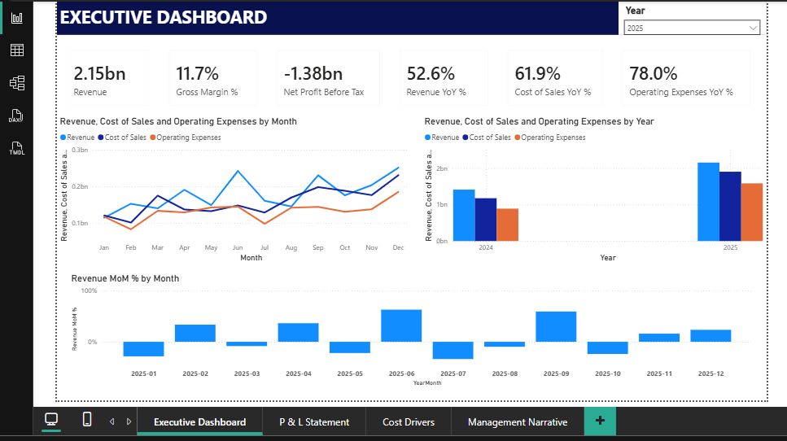
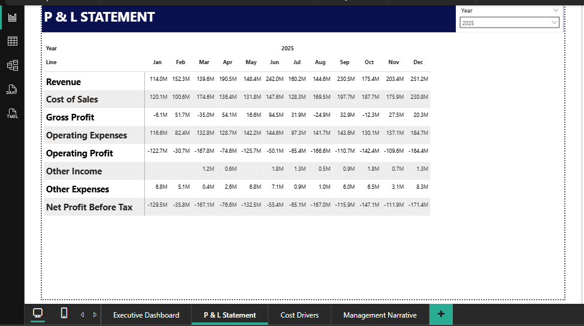
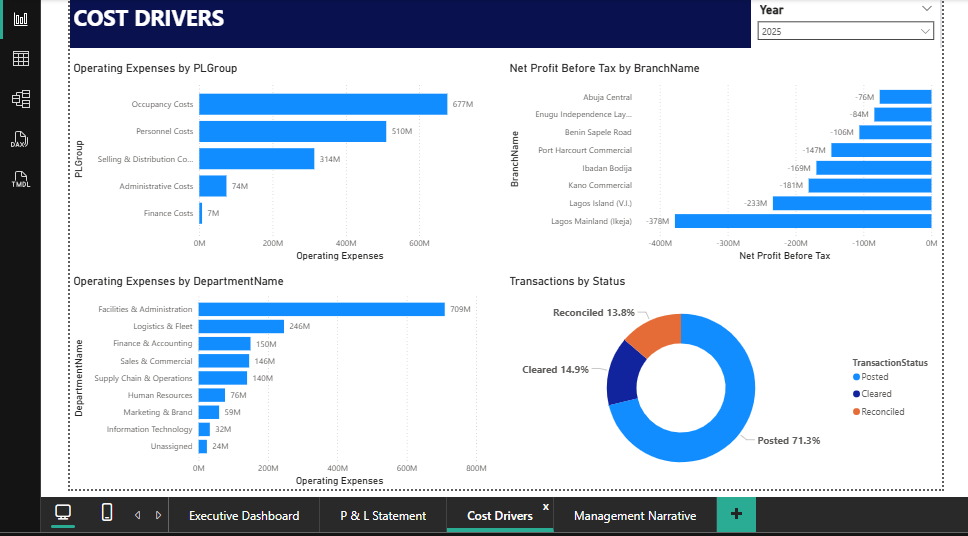
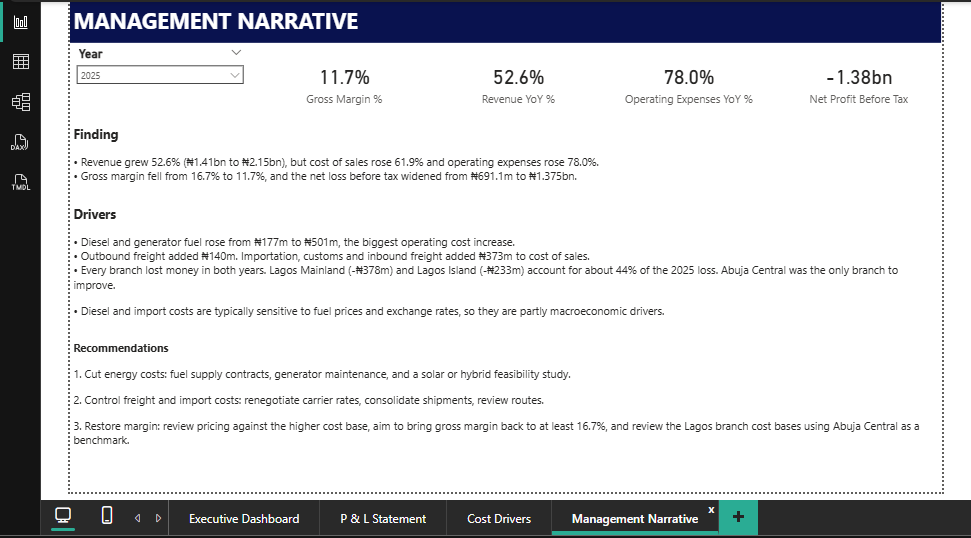
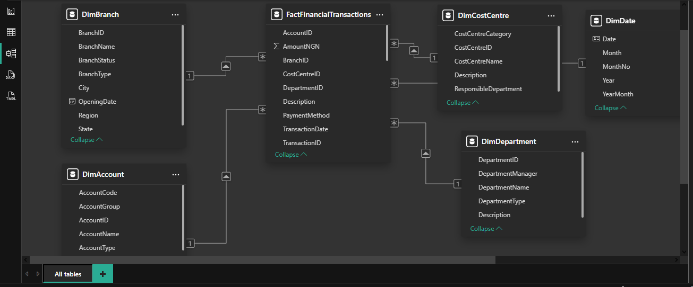

# FinSight Financial Analytics | Power BI Case Study


> **Revenue grew 52.6%, but the net loss before tax nearly doubled. Why?**
> An end-to-end Power BI financial reporting solution for a Nigerian FMCG distributor, covering 2024 and 2025.

---

## Table of Contents
1. [Introduction](#introduction)
2. [Business Problem](#business-problem)
3. [Key Findings](#key-findings)
4. [Report Pages](#report-pages)
5. [Data Model](#data-model)
6. [Data Preparation](#data-preparation)
7. [DAX Highlights](#dax-highlights)
8. [Recommendations](#recommendations)
9. [Conclusion](#conclusion)
10. [Skills Demonstrated](#skills-demonstrated)
11. [Repository Structure](#repository-structure)
12. [How to Open the Report](#how-to-open-the-report)
13. [About Me](#about-me)

---

## Introduction

This project is an end-to-end financial analytics and reporting solution developed in Power BI for FinSight Distribution & Consumer Products Ltd., a fictional Nigerian FMCG distribution company.

The company relied on static, error-prone Excel workbooks for financial reporting. Meanwhile, management observed a concerning trend: revenue was growing rapidly, but profit margins were declining.

Using approximately 4,500 financial transactions covering 2024 and 2025, I cleaned, transformed, and modelled the data in Power BI. I developed a monthly Profit and Loss (P&L) statement and investigated the key cost drivers affecting the company's profitability.

The project culminated in a four-page interactive Power BI report comprising:

    - Executive Dashboard: An overview of financial performance and key metrics.

    - Profit and Loss Statement: A detailed view of revenue, expenses, and profitability.

    - Cost Drivers Analysis: An investigation into the major factors contributing to rising costs.

    - Management Narrative: Key findings, business insights, and actionable recommendations.

---

## Business Problem

FinSight Distribution & Consumer Products Ltd. is a fictional mid-sized FMCG distributor operating in Lagos, Abuja, Port Harcourt, Ibadan, Kano, Benin City and Enugu. Its legacy reporting relied on manual Excel workbooks that were static and error-prone.

The Managing Director's concern: *"Revenue is surging, but our profit margins are actively compressing."*

**Central question:** Revenue increased significantly from 2024 to 2025. Why hasn't profit increased at the same rate?

**Objectives**

- Produce an interactive monthly Profit & Loss statement
- Compare 2024 vs 2025 performance (YoY and MoM)
- Pinpoint the expense drivers behind margin compression
- Evaluate branch-level and department-level cost efficiency
- Give data-backed recommendations to leadership

---

## Key Findings

| Measure | 2024 | 2025 | Change |
|---|---|---|---|
| Revenue | ₦1.410bn | ₦2.152bn | **+52.6%** |
| Cost of Sales | ₦1.174bn | ₦1.901bn | **+61.9%** |
| Operating Expenses | ₦888.7m | ₦1.582bn | **+78.0%** |
| Gross Margin | 16.7% | 11.7% | **-5.0 pts** |
| Net Profit Before Tax | -₦691.1m | -₦1.375bn | Loss widened |

**Costs grew faster than revenue**, so each extra naira of sales earned less profit.

**What drove the cost growth**

- **Operating expenses (+₦693m):** Occupancy costs rose ₦365m, driven by diesel and generator fuel (₦177m to ₦501m). Selling and distribution rose ₦171m, mostly outbound freight (+₦140m). Personnel costs rose ₦130m (+34%).
- **Cost of sales (+₦727m):** finished goods +₦346m, importation and customs clearance +₦228m (up 135%), inbound freight +₦145m (up 185%).
- **Branches:** every branch lost money in both years. Lagos Mainland (-₦378m) and Lagos Island (-₦233m) account for about **44%** of the 2025 loss. Abuja Central was the only branch to improve.

---

## Report Pages

### 1. Executive Dashboard
KPI cards, YoY comparison, monthly trend of revenue vs costs, and a Revenue MoM % chart. A Year slicer (single year or All) controls the page.



### 2. P&L Statement
A standardised income statement matrix: Revenue, Cost of Sales, Gross Profit, Operating Expenses, Operating Profit, Other Income, Other Expenses, Net Profit Before Tax. Expands from year level to monthly columns.



### 3. Cost Drivers
Operating expenses by P&L group and by department, net profit by branch, and a transaction status breakdown.



### 4. Management Narrative
A one-page summary of the findings, drivers and three recommendations, placed next to the key KPIs.



---

## Data Model

A strict **star schema** with one fact table (about 4,500 transactions), four dimensions from the source workbook, and a dynamic date table built in DAX.



| Table | Type | Purpose |
|---|---|---|
| `FactFinancialTransactions` | Fact | One row per financial transaction |
| `DimAccount` | Dimension | Chart of accounts and P&L structure |
| `DimDepartment` | Dimension | Corporate departments |
| `DimBranch` | Dimension | Branches by region and state |
| `DimCostCentre` | Dimension | Functional cost pools |
| `DimDate` | Dimension (DAX) | Calendar for time intelligence |
| `PL Layout` | Helper | Row order and labels for the P&L matrix |

---

## Data Preparation

All cleaning was done in Power Query. Issues found and how they were handled:

| Issue | Action |
|---|---|
| `TransactionDate` stored as text | Converted to Date |
| 96 blank `DepartmentID` and 58 blank `CostCentreID` values | Replaced with `DEP000` / `CC000` and added matching "Unassigned" rows to the dimensions, so these costs stay visible instead of being dropped |
| "Finance Costs" used as a group name in two P&L sections | Renamed the non-operating one to avoid a sort conflict |
| 8 repeated `TransactionReference` values | Checked: different accounts and amounts, so kept. `TransactionID` is the key |
| Debit and credit amounts all stored as positive numbers | Applied `NaturalSignMultiplier` from `DimAccount` in DAX |
| Branch opening dates back to 2018 would stretch `CALENDARAUTO` | Built the date table with `CALENDAR` from the fact table's MIN and MAX dates |
| Text columns with inconsistent spacing | Trimmed and cleaned |

---

## DAX Highlights

**Signed amounts and P&L lines**

```dax
Amount (Signed) =
SUMX(
    FactFinancialTransactions,
    FactFinancialTransactions[AmountNGN] * RELATED(DimAccount[NaturalSignMultiplier])
)

Revenue = CALCULATE([Amount (Signed)], DimAccount[PLSection] = "Revenue")
Cost of Sales = -CALCULATE([Amount (Signed)], DimAccount[PLSection] = "Cost of Sales")
Gross Profit = [Revenue] - [Cost of Sales]
Net Profit Before Tax = [Operating Profit] + [Other Income] - [Other Expenses]
```

**Time intelligence (YoY only when one year is selected)**

```dax
Revenue PY = CALCULATE([Revenue], SAMEPERIODLASTYEAR(DimDate[Date]))

Revenue YoY % =
IF(
    HASONEVALUE(DimDate[Year]),
    DIVIDE([Revenue] - [Revenue PY], [Revenue PY]),
    BLANK()
)

Revenue MoM % =
DIVIDE([Revenue] - CALCULATE([Revenue], DATEADD(DimDate[Date], -1, MONTH)),
       CALCULATE([Revenue], DATEADD(DimDate[Date], -1, MONTH)))
```

**Standardised P&L matrix using a layout table**

```dax
PL Value =
SWITCH(
    SELECTEDVALUE('PL Layout'[Line]),
    "Revenue", [Revenue],
    "Cost of Sales", [Cost of Sales],
    "Gross Profit", [Gross Profit],
    "Operating Expenses", [Operating Expenses],
    "Operating Profit", [Operating Profit],
    "Other Income", [Other Income],
    "Other Expenses", [Other Expenses],
    "Net Profit Before Tax", [Net Profit Before Tax]
)
```

---

## Recommendations

1. **Cut energy costs.** Diesel and generator fuel is the largest single cost increase. Negotiate fuel supply contracts, schedule generator maintenance, and study a solar or hybrid power option for the biggest sites.
2. **Control freight and import costs.** Inbound freight, outbound freight and customs together rose by about ₦513m. Renegotiate carrier rates, consolidate shipments and review delivery routes.
3. **Restore margin and fix the Lagos branches.** Review pricing against the higher cost base, aim to bring gross margin back to at least 16.7%, and review the Lagos Mainland and Lagos Island cost bases using Abuja Central as a benchmark.

Diesel and import costs are typically sensitive to fuel prices and exchange rates, so they are partly macroeconomic drivers.

---

## Conclusion

FinSight's 2025 growth was not profitable growth. Revenue rose 52.6%, but cost of sales rose 61.9% and operating expenses rose 78.0%, so gross margin fell from 16.7% to 11.7% and the net loss before tax nearly doubled to ₦1.375bn.

Diesel and generator fuel, freight, and importation and customs costs account for about 59% of the combined rise in operating and sales costs, and the two Lagos branches carry about 44% of the 2025 loss. Leadership should bring these cost lines under control before pursuing more revenue growth, using Abuja Central, the only branch that improved, as the internal benchmark.

---

## Skills Demonstrated

- **Data modelling:** star schema, relationships, dynamic date table
- **Power Query (M):** cleaning, null handling, appending dimension rows
- **DAX:** `CALCULATE`, `SUMX`, `RELATED`, time intelligence, `SWITCH`, `HASONEVALUE`
- **Financial reporting:** building a P&L statement and reading margin movement
- **Dashboard design:** layout, slicers, interactions, consistent formatting
- **Business storytelling:** turning findings into recommendations

---

## Repository Structure

```
finsight-power-bi-financial-analytics/
├── README.md
├── FinSight_Financial_Analytics_Project.pbix
├── data/
│   └── FinSight_Financial_Analytics_Project.xlsx
└── images/
    ├── 01_executive_dashboard.png
    ├── 02_pl_statement.png
    ├── 03_cost_drivers.png
    ├── 04_management_narrative.png
    └── data_model.png
```

---

## How to Open the Report

1. Download `FinSight_Financial_Analytics_Project.pbix`.
2. Open it in **Power BI Desktop** (free for Windows).
3. If Power BI shows a data source error, go to **Home > Transform data > Data source settings > Change Source**, and point it to the Excel file in the `data/` folder.
4. Set the Year slicer to **2025** to see the year-on-year figures.

---

## About Me

**Rukayat** | Computer Science student, building a data analytics portfolio.

- LinkedIn: [add your link]
- Email: [add your email]
- Portfolio: [add your link]

---

*This project uses a fictional case-study dataset for learning purposes. The company and figures are not real.*
